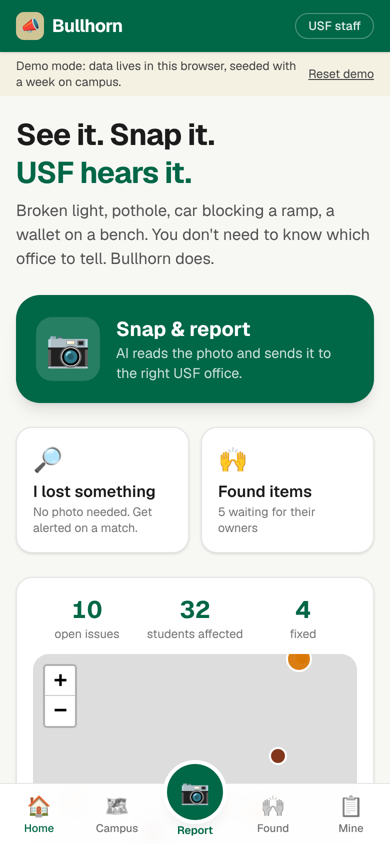
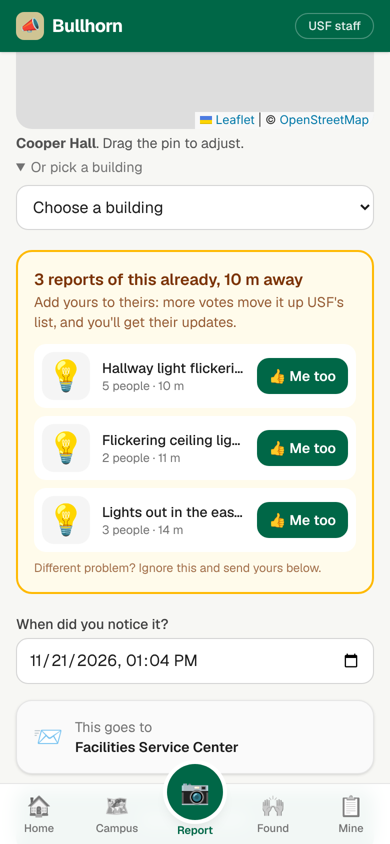
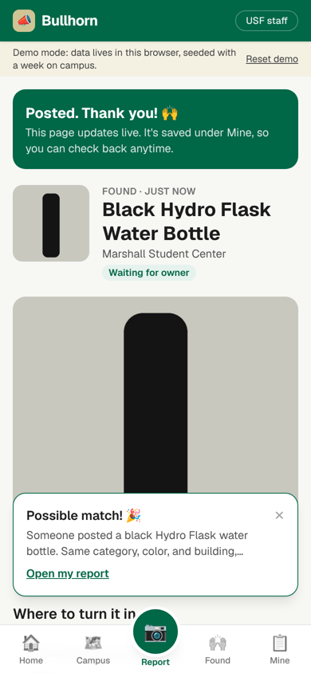
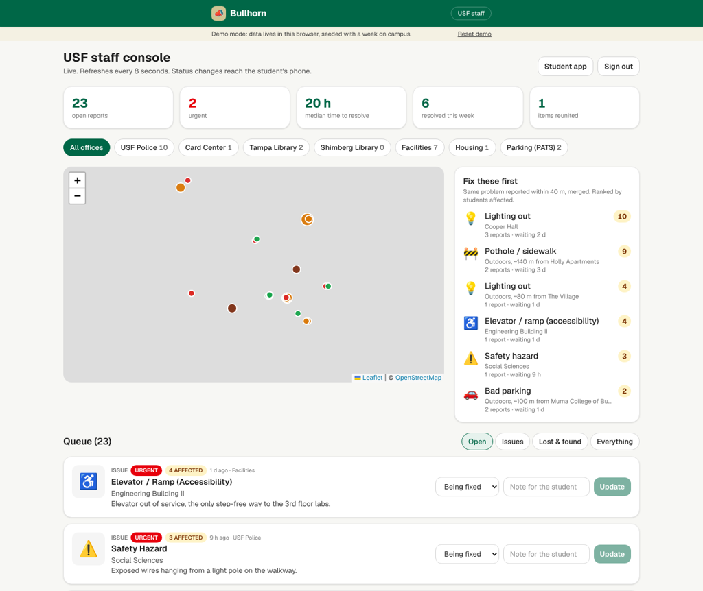
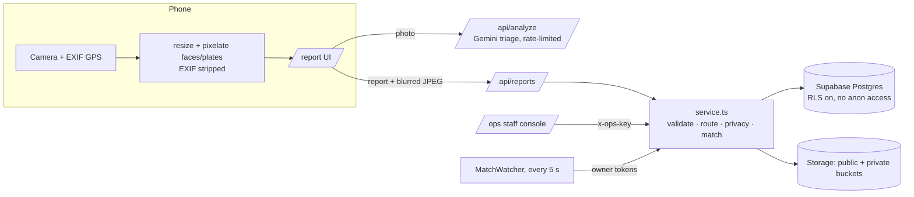

# 📣 Bullhorn: report anything at USF

**See it. Snap it. USF hears it.** HackJam 2026, Home Turf track.

A broken light, a pothole in the bike lane, a car parked across an accessible ramp, a wallet on a bench. Students see
these every day and say nothing, because nobody knows *which* of USF's offices to tell. Facilities, Housing, Parking &
Transportation, USF Police, two library desks, and the Card Center each own a slice of campus, with different contact
channels and different hours.

Bullhorn is one camera button. AI reads the photo, the app routes it to the office that owns it, and the student
hears back: a live status page, a pop-up when their lost item turns up, and a staff console where USF closes the loop.

| Snap | Already reported? | Your item turned up | USF staff console |
|---|---|---|---|
|  |  |  |  |

## Run it (zero setup)

```bash
npm install
npm run dev            # http://localhost:3000
```

With no environment variables it runs in **demo mode**: the same rules run in the browser against localStorage,
seeded with a believable week on campus (29 reports: a cluster of dead lights at Cooper Hall, potholes on Holly Drive,
a broken elevator in ENB, lost AirPods with a matching found post). The staff console passcode in demo mode is
`bulls`. Open two tabs to see a match alert arrive live. "Reset demo" in the yellow banner starts over.

```bash
npm run check          # lint + typecheck + 51 tests + matching eval
```

## What it does

| | |
|---|---|
| **One flow for everything** | `/report`: photo, then Gemini decides *item or problem*, what it is, how urgent, and where the faces, plates and ID cards are. The student confirms instead of filling a form. No photo? "I lost something" works without one. |
| **Map pins, not a building list** | The pin comes from the photo's GPS, the phone's location, or a tap. A pin within 70 m of a building is "in" it; anything else is outdoors, so potholes and parking lots work. |
| **Routing you can explain** | `src/lib/routing.ts` decides the office from *what* and *where*: parking → Parking & Transportation, safety → USF Police (with a 911 button), roads → Facilities, indoor problems in a dorm → Housing, in a library → that library, everything else → Facilities. Deterministic and tested; AI never routes. |
| **Duplicate detection** | Same problem type within 40 m? "3 reports of this already, 10 m away. Me too?" One vote per device. Votes rank the staff queue. |
| **Lost ↔ found matching** | Scored on category, color family (navy = blue), place, time and shared distinctive words, with a reason the student can read: *"Same category, color, and building, around the same time; both mention "sticker", "dent"."* |
| **Closing the loop** | Every report gets a live page (`/r/[id]`) with a status trail. "Mine" lists this phone's reports without an account. A watcher pops a notification when a match appears or staff update a status. |
| **USF staff console** | `/ops`: open/urgent/median time-to-resolve KPIs, a per-office queue sorted by priority (urgent, then people affected, then age), "fix these first" clusters, and status updates with a note that reaches the student. |
| **Installable** | PWA manifest and icons: "Add to Home Screen" and it opens like an app, with shortcuts for Snap and Lost. |

## How it is built



- **Next.js 15 (App Router) + TypeScript + Tailwind 4**, Leaflet + OpenStreetMap tiles, Zod, Vitest.
- **One rules layer, two backends.** `src/lib/service.ts` holds every business rule. On a server, API routes run it
  against Supabase with the service-role key; in demo mode the browser runs the *same functions* against
  localStorage. The demo is not a mock: it is the product with a different `Repo`.
- **The browser has no database access.** RLS is on with no anon policies; all writes go through API routes that
  validate with Zod, rate-limit, check same-origin, and authorize by owner token or staff passcode.

## Every claim has a test

| Claim | Where it is checked |
|---|---|
| A phone left in the library: ask the library desk before USF Police | `tests/routing.test.ts` |
| Bad parking always goes to Parking & Transportation; safety to Police, urgent | `tests/routing.test.ts` |
| Found IDs and parking reports are never public, but still reach the right office | `tests/privacy.test.ts`, `tests/service.test.ts` |
| A lost item's description (the owner's proof) is never shown to other students, and matched words are only revealed to the owner | `tests/service.test.ts` |
| Students cannot change an issue's status; staff can, and every change is in the trail | `tests/service.test.ts` |
| One "me too" per device | `tests/service.test.ts` |
| Bad input is refused by the server, not just the form (off-campus pins, missing type, 600-char text) | `tests/service.test.ts` |
| AI output is never trusted blindly (unknown enums dropped, boxes clamped, visible card forces "ID") | `tests/misc.test.ts` |
| Library hours that run past midnight; unknown hours say "not confirmed" instead of guessing | `tests/misc.test.ts` |
| Duplicates within 40 m, clusters ranked by people affected, queue order urgent > popular > old | `tests/duplicates.test.ts`, `tests/service.test.ts` |

### Matching, measured

`npm run eval` scores 24 hand-written lost reports against 40 found posts: each lost item's true counterpart,
described the way a *different* person would (other words, color synonyms, sometimes no building), plus 16 decoys
in the same categories.

| | category / color / place / time | + shared words (shipped) |
|---|---|---|
| True match ranked #1 | 95.8% | **100%** |
| Mean reciprocal rank | 0.979 | **1.000** |
| True match shown above the cut-off | 100% | 100% |
| Decoys also shown, per lost report | 1.08 | 1.13 |

Read it honestly: the set is synthetic and small, and we wrote it. It shows the score separates a true pair from
same-category decoys, and that shared words fix the case the basic rules ranked wrong. It also shows about one decoy
is shown per lost report, which is why the app never hands an item over: it sends the student to the office, and the
office checks the private description.

## Privacy and security by design

- **On-device redaction.** Gemini returns boxes for faces, plates, cards and screens; the phone pixelates them
  before upload. Re-encoding through a canvas also strips EXIF (including GPS) from every uploaded photo.
- **Private by category.** IDs/cards and parking reports (license plates) are routed to staff and never listed.
  Their photos go to a private bucket and are served only as 10-minute signed URLs.
- **Lost descriptions are secret.** They are how an office verifies an owner, so only the owner and staff see them.
  Lost/found pins are rounded to ~110 m in public views.
- **Owner tokens instead of accounts.** Creating a report returns a random token stored on the phone; it proves
  ownership for "I got it back" and live alerts. No sign-up, no personal data collected.
- **No open endpoints.** Server-side Zod validation, per-IP rate limits (reports, votes, AI, passcode guesses),
  same-origin checks on POSTs, a 2.5 MB JPEG-only upload limit enforced in code and in the bucket, security headers.
- **No real emails during testing.** Drafts go to `NEXT_PUBLIC_TEST_EMAIL` until USF says otherwise.

## Honest boundaries

- **This is a student prototype, not an official USF service.** Offices receive reports through the console and a
  ready-to-send email; nothing is integrated with USF's real work-order systems (Housing, for example, takes requests
  through Asset Essentials). That integration is the obvious next step and needs USF's permission.
- **The staff console uses one shared passcode**, not per-person accounts or roles. Fine for a demo, not for
  production (next: Supabase Auth with @usf.edu SSO and per-office roles).
- **Rate limits are in memory**, so on serverless they apply per warm instance. They stop a script during a demo;
  a real deployment needs a shared store (e.g. Upstash Redis).
- **Gemini free tier:** Google may use free-tier inputs to improve its products. Redaction happens on the phone
  *after* analysis, so the original photo reaches Gemini. Production should use a paid tier / Vertex AI with data
  terms USF approves.
- **AI can miss a face or plate.** Parking reports are private regardless, and staff see the photo before acting.
- **Office data is hand-checked** against usf.edu pages on 2026-11-21 (source URL above each entry in
  `src/lib/offices.ts`). Parking hours and USF Police property-pickup hours are not published there, so the app
  shows "not confirmed" rather than guessing. The Village pin is unconfirmed.
- **Live alerts poll every 5 seconds** while the app is open. Push notifications when the app is closed (Web Push)
  are not built yet.

## Deploy (free tiers, no card)

1. **Supabase**: new project → SQL Editor → paste `supabase/schema.sql` → Run. Optionally load the demo week:
   `npm run seed:sql > seed.sql` and run that too.
2. **Vercel**: import the repo, set `NEXT_PUBLIC_SUPABASE_URL`, `SUPABASE_SERVICE_ROLE_KEY`, `OPS_PASSCODE`,
   `GEMINI_API_KEY`, `NEXT_PUBLIC_TEST_EMAIL` (see `.env.example`). Deploy.
3. Before the demo: open the Supabase project (free projects pause), run each demo photo through once so the AI
   result is cached on the demo phone, and follow [`docs/DEMO.md`](docs/DEMO.md).

## Code map

| Path | What |
|---|---|
| `src/lib/service.ts` | Every rule: create, who sees what, matches, me-too, status permissions, stats, queue priority |
| `src/lib/routing.ts` | Which office, and why |
| `src/lib/matching.ts`, `scripts/eval-matching.ts` | Lost ↔ found score and its evaluation |
| `src/lib/duplicates.ts` | "Already reported" and staff clusters |
| `src/lib/privacy.ts` | Visibility and the public view |
| `src/lib/analysis.ts`, `src/app/api/analyze` | Gemini triage and the guardrails on its output |
| `src/lib/photo.ts` | Resize, EXIF strip, pixelation |
| `src/lib/client.ts` | The one API the UI calls (demo mode or server) |
| `src/lib/offices.ts`, `src/lib/buildings.ts` | Hand-verified USF data with sources |
| `src/app/report`, `src/app/r/[id]`, `src/app/ops` | Report flow, live report page, staff console |
| `supabase/schema.sql` | Tables, constraints, locked-down RLS, buckets |
| `docs/DEMO.md`, `docs/TEAM.md` | 3-minute demo script, who does what |
